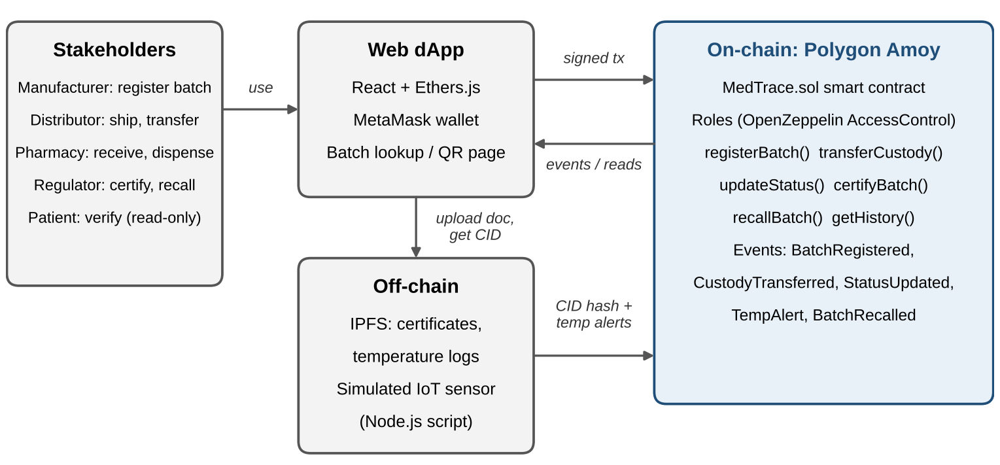

# MedTrace: Blockchain-Based Provenance for Pharmaceutical Supply Chains

**CSE 540: Engineering Blockchain Applications (Fall B 2026), Project 1**
**Team BlockRx:** Shrey Bishnoi, Maulik Jadav, Neric Joel, Vaibhav Abhiramacheri, Rohan Chandrashekar

> **Status: Final Project (due 12/04/2026).** The contract is deployed and verified on Polygon Amoy, every role has a page in the web app, and the test suite (120 tests) covers 100 % of statements, branches, functions and lines. Section 6 takes you from a fresh clone to a running app.

---

## 1. Project Description

Prescription medicines pass through manufacturers, distributors, and pharmacies, and each of them keeps its own records. Because there is no shared, tamper-proof history, counterfeit or badly stored drugs can slip into the chain, and patients cannot easily check where their medicine came from.

**MedTrace** records every **batch** (one production lot of one medicine) on a blockchain:

- **Origin:** who made the batch, when, and its allowed storage temperature range
- **Custody:** every hand-off, signed by both the sender and the receiver
- **Documents:** certificates and logs stored on IPFS, with only their hashes (CIDs) kept on-chain
- **Cold chain:** temperature alerts from a simulated IoT sensor
- **Regulator actions:** certification and recalls

Anyone - including a patient, can look up a batch and see its full history and a simple **"safe to use"** answer.

### Stakeholders and roles

| Role | Who | What they can do on-chain |
|---|---|---|
| Admin | Network operator (deployer) | Onboard or remove participants |
| Manufacturer | Drug maker | `registerBatch`, start hand-offs, attach documents |
| Distributor | Wholesaler or logistics firm | `confirmReceipt`, pass the batch on |
| Pharmacy | Retail or hospital pharmacy | `confirmReceipt`, `markDispensed` |
| Regulator | Health authority | `certifyBatch`, `recallBatch`, attach certificates |
| Sensor | IoT simulator wallet | `recordTemperatureAlert` |
| Patient | Public | Read-only: `verifyBatch`, `getHistory` (free, no wallet needed) |

## 2. Architecture



- **On-chain (Polygon Amoy testnet):** the `MedTrace` contract stores batch state, history, and document CIDs, and emits an event for every action.
- **Off-chain storage (IPFS):** Certificates of Analysis, temperature logs, and shipping records.
- **Simulated IoT (Node.js):** generates temperature readings and writes only out-of-range readings on-chain to save gas.
- **Web dApp (React + Ethers.js + MetaMask):** one page per stakeholder, plus a public "verify my medicine" page.

The full design, including the status state machine, the hand-off sequence, and the design decisions, is in [`docs/design.md`](docs/design.md).

## 3. Repository Structure

```
medtrace/
├── contracts/
│   ├── MedTrace.sol                # main contract: batches, custody, documents, alerts, views
│   ├── interfaces/
│   │   └── IMedTrace.sol           # public interface: types, events, function signatures
│   └── access/
│       └── MedTraceAccess.sol      # role-based access control (OpenZeppelin AccessControl)
├── test/                           # Hardhat + Chai tests (120 passing, 100 % coverage)
│   ├── MedTrace.test.js            # core flow, lot lookup, breach dispense rule, history pages (21)
│   ├── MedTrace.edgecases.test.js  # custody, dispensing, expiry, recall, documents, access (55)
│   ├── MedTrace.lifecycle.test.js  # multi-step journeys: verdict, expiry, documents, history (20)
│   └── deploy.test.js              # deploy script: helpers, files it writes, verification (24)
├── scripts/
│   ├── deploy.js                   # deploy to localhost or Polygon Amoy, then verify
│   ├── seedDemo.js                 # local demo: deploy, one wallet per role, one batch end to end
│   └── onboardDemo.js              # Amoy demo: onboard the team wallets and top up their POL
├── deployments/
│   ├── amoy.json                   # written by deploy.js: address, tx hash, block
│   └── amoy-demo-participants.json # public addresses of the Amoy demo wallets
├── offchain/
│   ├── ipfs/uploadToIpfs.js        # IPFS upload helper for scripts (Pinata)
│   └── iot-simulator/simulateSensor.js  # temperature sensor simulator
├── frontend/                       # React + Vite web app, one page per role (see frontend/README.md)
│   ├── src/lib/ipfs.js             # IPFS upload helper for the browser (upload-only key)
│   ├── src/pages/                  # Factory, Distributor, Pharmacy, Regulator, Admin, Verify (patient)
│   └── scripts/sync-contract.mjs   # writes src/contract.json (address + ABI) for a network
├── docs/
│   ├── architecture.png            # system architecture diagram
│   └── design.md                   # detailed design notes
├── hardhat.config.js
├── package.json
└── .env.example                    # template for secrets (never commit .env)
```

## 4. Smart Contract Overview

The interface (`IMedTrace.sol`) defines every type, event, and function. `MedTrace.sol` implements it.

| Function | Caller | Purpose |
|---|---|---|
| `registerParticipant(account, role, name)` | Admin | Onboard a wallet with a role and display name |
| `registerBatch(product, lot, expiry, minTemp, maxTemp, coaCid)` | Manufacturer | Create a batch; caller becomes its first holder |
| `transferCustody(batchId, to)` | Current holder | Step 1 of a hand-off (status becomes `InTransit`) |
| `confirmReceipt(batchId)` | Receiver | Step 2 of a hand-off (status becomes `Received`) |
| `markDispensed(batchId)` | Pharmacy holder | Final step: medicine given to patients |
| `attachDocument(batchId, docType, cid)` | Holder or Regulator | Link an IPFS document |
| `recordTemperatureAlert(batchId, reading, logCid)` | Sensor | Log an out-of-range temperature |
| `certifyBatch(batchId, certCid)` | Regulator | Approve the batch |
| `recallBatch(batchId, reason)` | Regulator | Pull the batch; it is frozen afterwards |
| `removeParticipant(account, role)` | Admin | Take a role away (for example a pharmacy that loses its licence) |
| `getBatch` / `getHistory` / `getDocuments` | Anyone | Read the batch record, audit trail, and documents |
| `getHistoryPage(batchId, offset, limit)` | Anyone | One page of the audit trail plus the total count, for long histories |
| `getBatchIdsByLot(lotNumber)` | Anyone | Batch IDs for the lot number printed on the box (exact match) |
| `totalBatches()` | Anyone | Number of batches registered so far (also the newest batch ID) |
| `verifyBatch(batchId)` | Anyone | Returns `exists`, `safeToUse`, `status`, and `holder` for the patient page |

**Custom errors:** Contract validation uses named custom errors; see [the error names and integration handoff](docs/custom-errors.md) for test assertions, suggested frontend messages, and deployment compatibility.

**Events:** `BatchRegistered`, `CustodyTransferred`, `ReceiptConfirmed`, `BatchDispensed`, `DocumentAttached`, `TempAlert`, `BatchCertified`, `BatchRecalled`, `ParticipantRegistered`, `ParticipantRemoved`.

**Batch status flow:** `Created → InTransit → Received → (InTransit → Received …) → Dispensed`. A regulator can move any batch that hasn't been dispensed to `Recalled`.

## 5. Dependencies

| Tool | Version | Purpose |
|---|---|---|
| [Node.js](https://nodejs.org/) | 18 or newer (20 LTS recommended) | Runs Hardhat and the scripts |
| [Hardhat](https://hardhat.org/) | ^2.22 | Compile, test, deploy |
| @nomicfoundation/hardhat-toolbox | ^5.0 | Ethers.js v6, Chai matchers, gas reporter, verification |
| [@openzeppelin/contracts](https://docs.openzeppelin.com/contracts/5.x/) | ^5.0 | Audited `AccessControl` |
| Solidity | 0.8.24 | Contract language (Hardhat downloads it automatically) |
| dotenv | ^16 | Loads secrets from `.env` |
| React, Vite, react-router-dom | ^18.3, ^5.4, ^6.26 | Web app (`frontend/`) |
| [MetaMask](https://metamask.io/) | Browser extension | Wallet for testnet transactions |
| IPFS pinning service ([Pinata](https://pinata.cloud/)) | Free tier | Off-chain document storage |

## 6. Setup

You need [Node.js](https://nodejs.org/) 18 or newer and Git. MetaMask is only needed for the Amoy testnet; on a local chain you can act as any role without it.

```bash
git clone https://github.com/abhiramacheri-vaibhav/MedTrace.git
cd MedTrace
npm install                            # contracts, tests and scripts
cd frontend && npm install && cd ..    # web app
```

A `.env` file is only needed for the testnet, the sensor simulator and IPFS uploads:

```bash
cp .env.example .env        # PowerShell: Copy-Item .env.example .env
```

`.env.example` explains every value. `.env` is git-ignored; never commit it or any private key.

## 7. Usage

### Compile and test

```bash
npx hardhat compile
npx hardhat test                    # 120 tests
npm run coverage                    # coverage report, also written to coverage/index.html
REPORT_GAS=true npx hardhat test    # also print gas cost per function
```

On Windows PowerShell, set the variable first (it stays set for that window):

```powershell
$env:REPORT_GAS = "true"; npx hardhat test
```

### Test coverage

`npm run coverage` (solidity-coverage, part of the Hardhat toolbox) runs the whole suite against an instrumented copy of the contracts.

| File | Statements | Branches | Functions | Lines |
|---|---:|---:|---:|---:|
| `MedTrace.sol` | 100 % | 100 % | 100 % | 100 % |
| `access/MedTraceAccess.sol` | 100 % | 100 % | 100 % | 100 % |
| `interfaces/IMedTrace.sol` | 100 % | 100 % | 100 % | 100 % |

Every rejected call is tested with its exact custom error and, where it matters, a check that the batch did not change. The suites cover each role's permissions, every status change, unknown batch IDs (0 and past the end), expiry down to the second, readings exactly on the temperature limits, empty strings, document types outside the list, and paging with empty, single-entry and maximum-size pages.

### Gas report

Measured on the local Hardhat network with Solidity 0.8.24, optimizer on (200 runs) and `evmVersion` cancun, over the full test suite (120 tests). To reproduce, run `REPORT_GAS=true npx hardhat test` (PowerShell form above). Figures are gas units; `-` means the reporter saw only one value.

| Function | Min | Max | Avg | Calls |
|---|---:|---:|---:|---:|
| `registerBatch` | 287,152 | 440,542 | 421,907 | 87 |
| `certifyBatch` | 65,812 | 207,922 | 144,762 | 18 |
| `recordTemperatureAlert` | 66,107 | 208,460 | 182,358 | 11 |
| `attachDocument` | 155,381 | 157,837 | 156,216 | 12 |
| `recallBatch` | 88,387 | 91,259 | 89,077 | 13 |
| `registerParticipant` | 36,066 | 75,561 | 75,361 | 543 |
| `transferCustody` | 72,603 | 75,117 | 73,491 | 65 |
| `confirmReceipt` | - | - | 72,257 | 51 |
| `markDispensed` | - | - | 66,985 | 12 |
| `removeParticipant` | - | - | 28,890 | 4 |

**Deployment:** `MedTrace` costs 2,762,390 gas, 4.6 % of the block gas limit (60,000,000 on the local Hardhat network).

Switching from revert strings to custom errors cut deployment gas by 252,407 (8.4 %, down from 3,014,797), because the 23 error messages no longer sit in the contract bytecode. Successful calls cost almost the same as before (within about 20 gas), since custom errors only change the code path that runs when a check fails. A rejected call is 63 to 116 gas cheaper, as it returns a 4-byte error selector instead of an ABI-encoded message.

`registerBatch` is the most expensive call because it stores a new batch record with two strings (product name and lot number), adds the batch to the lot-number index, and writes a history entry that repeats the product name; with a Certificate of Analysis CID it also stores a document and a second history entry. The wide range for `certifyBatch` and `recordTemperatureAlert` comes from the same pattern: when a CID is passed, it is written into the history entry and into a separate document record. Every batch action appends a history entry, so even simple steps such as `confirmReceipt` and `markDispensed` cost around 66,000-73,000 gas. The `registerParticipant` minimum is a wallet that already has the role being onboarded again, which only rewrites its display name. `verifyBatch` and `getHistory` are view functions, so a patient checking a batch sends no transaction and pays nothing.

The `registerBatch` minimum and average move by a few gas units between runs: the tests derive expiry dates from the current block time, and calldata cost depends on the bytes of that timestamp. All other figures are stable.

### Run the whole app locally

This needs three terminals, each starting in the repo folder. Nothing here costs real money; the local chain gives you 20 funded test accounts.

```bash
# Terminal 1: a local blockchain (leave it running)
npx hardhat node
```

```bash
# Terminal 2: deploy, onboard one wallet per role, and walk one batch to the pharmacy
npm run seed:local
```

The seed script prints the contract address and one wallet per role. On a fresh node they are always:

| Role | Name | Address (Hardhat account) |
|---|---|---|
| Contract | MedTrace | `0x5FbDB2315678afecb367f032d93F642f64180aa3` |
| Admin | deployer | `0xf39Fd6e51aad88F6F4ce6aB8827279cffFb92266` (#0) |
| Manufacturer | Acme Pharma | `0x70997970C51812dc3A010C7d01b50e0d17dc79C8` (#1) |
| Distributor | FastMed Logistics | `0x3C44CdDdB6a900fa2b585dd299e03d12FA4293BC` (#2) |
| Pharmacy | Tempe Pharmacy | `0x90F79bf6EB2c4f870365E785982E1f101E93b906` (#3) |
| Regulator | Drug Regulator | `0x15d34AAf54267DB7D7c367839AAf71A00a2C6A65` (#4) |
| Sensor | IoT Simulator | `0x9965507D1a55bcC2695C58ba16FB37d819B0A4dc` (#5) |

It also registers batch 1 (Insulin 100IU, lot `LOT-2026-001`), has the regulator certify it and moves it to the pharmacy.

```bash
# Terminal 3: point the web app at the local contract and start it
cd frontend
npm run sync-contract -- 0x5FbDB2315678afecb367f032d93F642f64180aa3 localhost
npm run dev
```

Open http://localhost:5173. `sync-contract` writes `frontend/src/contract.json` (address and ABI). That file is git-ignored, so run it again whenever you redeploy or switch networks. If you restart `npx hardhat node`, the chain starts empty, so run `npm run seed:local` again.

**Acting as a role without MetaMask (local chain only).** Add `?as=<address>` to a page link and the app signs with that unlocked Hardhat account:

- Factory: http://localhost:5173/factory?as=0x70997970C51812dc3A010C7d01b50e0d17dc79C8
- Distributor: http://localhost:5173/distributor?as=0x3C44CdDdB6a900fa2b585dd299e03d12FA4293BC
- Pharmacy: http://localhost:5173/pharmacy?as=0x90F79bf6EB2c4f870365E785982E1f101E93b906
- Regulator: http://localhost:5173/regulator?as=0x15d34AAf54267DB7D7c367839AAf71A00a2C6A65
- Admin: http://localhost:5173/admin?as=0xf39Fd6e51aad88F6F4ce6aB8827279cffFb92266
- Patient (no wallet at all): http://localhost:5173/verify?lot=LOT-2026-001

The app ignores `?as=` on any public network. To use MetaMask locally instead, add a network with RPC `http://127.0.0.1:8545` and chain ID `31337`, then import the private keys that `npx hardhat node` prints for the accounts above. Those keys are public test keys, so never send real funds to them.

### A full walkthrough

With the app running locally, this follows one new batch through every role:

1. **Factory** (`/factory`): register a batch with a product name, lot number, expiry date and safe temperature range (in °C). A Certificate of Analysis IPFS CID is optional. The factory is the first holder.
2. **Regulator** (`/regulator`): certify the batch. A batch only counts as "safe to use" once it is certified. The regulator can also recall any batch that has not been dispensed, with a reason.
3. **Factory**: hand the batch to the distributor (drag the box along the road, or use the hand-off button). The status becomes `InTransit`.
4. **Distributor** (`/distributor`): accept the delivery (status `Received`), then hand it on to the pharmacy.
5. **Pharmacy** (`/pharmacy`): accept the delivery, then dispense it. Dispensing is refused if the batch is expired, recalled, or has had a temperature alert.
6. **Sensor** (optional): run the temperature simulator (below) against the batch ID to record an out-of-range reading. The batch then shows a flame on its road and can no longer be dispensed.
7. **Patient** (`/verify`, no wallet): type the lot number from the box, or open `/verify?lot=<lot number>` directly. The page shows "safe to use" or the reason it is not, plus the batch's journey and documents, and it updates live when a recall or alert happens.

**Admin** (`/admin`): onboard a new wallet with a role and a display name, or remove a role.

The same steps work against the Amoy deployment once the app is synced to it (section 8), with each role's wallet connected through MetaMask.

### Interacting from the console

Every function in section 4 can also be called from a Hardhat console, which is handy for checking state:

```bash
npx hardhat console --network localhost
```

```js
const mt = await ethers.getContractAt("MedTrace", "0x5FbDB2315678afecb367f032d93F642f64180aa3");
await mt.totalBatches();                   // 1n after seed:local
await mt.verifyBatch(1);                   // [exists, safeToUse, status, holder]
await mt.getBatchIdsByLot("LOT-2026-001"); // [1n]
(await mt.getHistory(1)).length;
```

Status numbers are `0 Created`, `1 InTransit`, `2 Received`, `3 Dispensed`, `4 Recalled`.

### Run the temperature simulator (local)

After `seed:local`, set `CONTRACT_ADDRESS` and `SENSOR_PRIVATE_KEY` in `.env`. Use the sensor account's private key, which `npx hardhat node` prints as Account #5. Then run:

```bash
BATCH_ID=1 npm run iot:simulate
```

The simulator prints a reading every 3 seconds. When a reading is out of range, it uploads the full reading log to IPFS and records the alert on-chain with that log's CID. The CID also shows up in the batch's documents. By default it stops after one alert. Optional settings: `MAX_ALERTS` (`0` runs until Ctrl+C), `INTERVAL_MS`, `SPIKE_CHANCE` (0 to 1, default 0.1). If `PINATA_JWT` is not set, or the upload fails, the alert is still recorded, just without a log CID.

To run it on Amoy:

1. In `.env`, set `RPC_URL=https://polygon-amoy-bor-rpc.publicnode.com`, `CONTRACT_ADDRESS` to the current address (section 8 or `deployments/amoy.json`; it changes with every redeploy) and `SENSOR_PRIVATE_KEY` to a test-only wallet.
2. Have the admin give that wallet `SENSOR_ROLE` (Admin page or `registerParticipant`). Roles don't carry over to a new deployment. The wallet also needs a little test POL for gas.
3. Choose a **spare** batch. One alert marks the batch as breached for good: it can never be dispensed, and the patient page shows "Do not use".
4. Run `BATCH_ID=<id> npm run iot:simulate`. It prints the IPFS link to the log and the Polygonscan link to the alert.

In PowerShell, set variables first: `$env:BATCH_ID=1; npm run iot:simulate`.

| Message | What to do |
|---|---|
| `does not have SENSOR_ROLE` | Ask the admin to register the wallet on the current contract |
| `No contract at …` | `RPC_URL` and `CONTRACT_ADDRESS` don't belong to the same network |
| `Batch … does not exist` | Register a batch first, or check `BATCH_ID` |
| `is Dispensed` / `is Recalled` | The batch is final; use another one |
| `recording the alert without a log CID` | The alert continues without its log; check `PINATA_JWT` if you want the log |

### Upload a document to IPFS

Files on IPFS are **public and hard to take back**, so never upload patient data. Only the CID goes on-chain.

**From the command line.** Set `PINATA_JWT` in `.env` (Pinata dashboard → API Keys), then:

```bash
node offchain/ipfs/uploadToIpfs.js --test              # check the JWT works
node offchain/ipfs/uploadToIpfs.js path/to/coa.pdf     # prints the CID and a gateway link
```

From code: `const { uploadFile, uploadJson, gatewayUrl } = require("./offchain/ipfs/uploadToIpfs")`.

**From the web app.** The factory form always accepts a pasted IPFS link or CID, with no key needed. For direct uploads, `frontend/src/lib/ipfs.js` uses a Pinata key that can only upload:

1. In the Pinata dashboard → API Keys → New Key, leave Admin off, allow only `pinFileToIPFS`, and limit the number of uses if offered.
2. `cp frontend/.env.example frontend/.env`, then set `VITE_PINATA_UPLOAD_JWT` to that key's JWT.
3. Restart `npm run dev`.

`isUploadConfigured()` says whether a key is set, and `uploadDocument(file)` returns the CID. Accepted files: PDF, PNG, JPG, JSON, CSV and TXT, up to 10 MB.

*Why a separate key?* Anything in the web page can be read by whoever opens it, and Vite copies the key into the page. The scripts' `PINATA_JWT` can do more than upload (listing our files, for example), so it stays in the root `.env` for scripts only. The upload-only key can still be copied and used to fill our storage quota, and the size and type checks run in the browser, so they don't stop someone who has the key. We accept that for a course demo: the key is never committed, and it should be revoked once the demo is over. A production version would put a small server in front that checks the caller and hands out short-lived signed upload URLs.

## 8. Deployment to Polygon Amoy Testnet

The team deployment is already live (table below), so you only need these steps to deploy your own copy or to redeploy after a contract change.

1. Add the Polygon Amoy network to MetaMask (Chain ID `80002`, RPC `https://polygon-amoy-bor-rpc.publicnode.com`, currency `POL`, explorer `https://amoy.polygonscan.com`). The older `rpc-amoy.polygon.technology` address no longer resolves.
2. Get free test POL for the deployer wallet from the [Polygon faucet](https://faucet.polygon.technology/). A deployment uses about 3 million gas.
3. Fill in `.env` (copied from `.env.example`):
   - `PRIVATE_KEY`: the deployer's private key, 64 hex characters. Use a test-only wallet, never one that holds real funds.
   - `ETHERSCAN_API_KEY`: only needed for source verification. One key from etherscan.io works for Amoy through Etherscan API V2, so no separate Polygonscan key is needed.
   - `AMOY_RPC_URL` can stay as it is.
4. Deploy:
   ```bash
   npm run deploy:amoy
   ```
   The script:
   - checks the wallet first and stops with a clear message if `PRIVATE_KEY` is missing or the wallet has no POL (it also warns if the balance looks too low for the estimated cost);
   - deploys `MedTrace` with the deployer as admin, printing the transaction hash as soon as it is sent and the address and explorer links once it is mined;
   - writes `deployments/amoy.json` (address, deployer, tx hash, block number, time, explorer link) and `frontend/src/contract.json` (address and ABI for the web app);
   - if `ETHERSCAN_API_KEY` is set, waits 5 confirmations and verifies the source on the block explorer, retrying if the explorer has not indexed the contract yet.

   A failed verification does not undo the deployment. `deployments/amoy.json` holds only public data and should be committed.
5. If verification was skipped or failed, run it by hand (the script prints this command with the real values filled in):
   ```bash
   npx hardhat verify --network amoy <CONTRACT_ADDRESS> <ADMIN_ADDRESS>
   ```
6. Point the web app at the new contract. `sync-contract` reads the deploy block from `deployments/amoy.json`; the app needs it to read past events:
   ```bash
   cd frontend
   npm run sync-contract -- <CONTRACT_ADDRESS> amoy
   npm run dev
   ```
7. Onboard the participants. Roles and batches do not carry over from an older deployment. For the team's demo wallets, put the new address in `deployments/amoy-demo-participants.json` (or set `CONTRACT_ADDRESS` in `.env`) and run `npm run demo:onboard` (see below). For any other wallet, use the Admin page of the web app.
8. After a redeploy, update the address in the table below and in `deployments/amoy-demo-participants.json`, and tell the team so everyone re-runs `sync-contract`.

### Deployed contract (Polygon Amoy)

| | |
|---|---|
| Contract | [`0x194b7DdB2c70b89F8E8A312A9eaAdb8f6cb7A491`](https://amoy.polygonscan.com/address/0x194b7DdB2c70b89F8E8A312A9eaAdb8f6cb7A491) |
| Deployment tx | [`0xd8e2e839…4dc5fc0a`](https://amoy.polygonscan.com/tx/0xd8e2e8390d291727c05f7aaf0dea2897ebcc21cf95fdd45c84d1e0ea4dc5fc0a) |
| Block | 53479958 (2026-11-21) |
| Admin (deployer) | `0xfd3E9AaCF697e02F9a186109838C9d2fD4A6dc78` |
| Chain ID | 80002 |
| Source | [Verified on Polygonscan](https://amoy.polygonscan.com/address/0x194b7DdB2c70b89F8E8A312A9eaAdb8f6cb7A491#code) |

The same details are in [`deployments/amoy.json`](deployments/amoy.json). To point the web app at this contract, run `npm run sync-contract -- 0x194b7DdB2c70b89F8E8A312A9eaAdb8f6cb7A491 amoy` in `frontend/`. Anyone can use the patient page (`/verify`) against it without a wallet; each role page needs a wallet that has been onboarded with that role.

This deployment (21 Nov 2026) includes lot-number lookup, the temperature-breach dispense rule, history pagination and named custom errors. It replaces two earlier deployments that should no longer be used: `0x2749c1613F6dfF8283434885b985d287AC5FA2B8` (10 Nov, text error messages) and `0x761F1e5344E376aB658e6d2AD8bA2f809c7C2A3f` (the first one, before lot lookup and pagination).

To onboard the demo participants (Acme Pharma, FastMed Logistics, Tempe Pharmacy, Drug Regulator) and give each one 0.15 test POL for gas, the admin runs this with the deployer's `PRIVATE_KEY` in `.env`. The wallets are listed in [`deployments/amoy-demo-participants.json`](deployments/amoy-demo-participants.json). Re-running it is safe, because finished steps are skipped.

```bash
npm run demo:onboard
```

## 9. Roadmap

| Milestone | Date | Scope | Status |
|---|---|---|---|
| Smart Contract Design Draft | 11/01/2026 | Interfaces, roles, core logic, repo, README, first tests | ✅ Done |
| Interim Demo | 11/15/2026 | Amoy deployment and verification, lot lookup, breach dispense rule, paged history, IPFS uploads, sensor alerts with real CIDs, a page for every role, live patient page | ✅ Done |
| Code freeze | 11/25/2026 | Custom contract errors, file upload from the web app, QR codes on batch cards, 100 % test coverage, refreshed gas table, final README | In progress |
| Final Project | 12/04/2026 | Final code, IEEE report, presentation and demo video | Planned |

**Out of scope:** real sensor hardware, mainnet deployment, and integration with existing industry systems.

## 10. Team and Ownership

Every member owns a blockchain development task. Commit history in each area is the record of who built what.

| Member | Development task | Owns |
|---|---|---|
| Shrey Bishnoi | Web3 front-end app: MetaMask connection, Ethers.js contract wiring, role-based pages (manufacturer, distributor, pharmacy, regulator) | `frontend/` (app shell and role pages) |
| Vaibhav Abhiramacheri | Access control and regulator module, plus the patient "verify batch" page with live event listeners | `contracts/access/`, `certifyBatch` / `recallBatch`, `frontend/src/pages/Verify*` |
| Maulik Jadav | Core batch and custody logic: lot-number lookup, `getHistory` pagination, dispense policy on temperature breach | `contracts/MedTrace.sol` |
| Neric Joel | Contract tests, edge cases, coverage and gas report, plus Amoy deployment, explorer verification and the setup, usage and deployment docs | `test/`, `scripts/`, README sections 6 to 9 |
| Rohan Chandrashekar | IPFS uploads (real CIDs on-chain) and the IoT simulator alert flow | `offchain/` |

**Workflow:** feature branches and pull requests, with at least one teammate reviewing each PR before merge. Tasks are tracked on the GitHub Projects board.

## 11. References

1. S. Nakamoto, "Bitcoin: A peer-to-peer electronic cash system," 2008.
2. V. Buterin, "Ethereum: A next-generation smart contract and decentralized application platform," 2013.
3. T. Bocek et al., "Blockchains everywhere – A use-case of blockchains in the pharma supply-chain," IFIP/IEEE IM, 2017.
4. MediLedger Project, "MediLedger DSCSA pilot project final report," 2020.
5. OpenZeppelin, *Access Control*: https://docs.openzeppelin.com/contracts/5.x/access-control

## License

MIT
