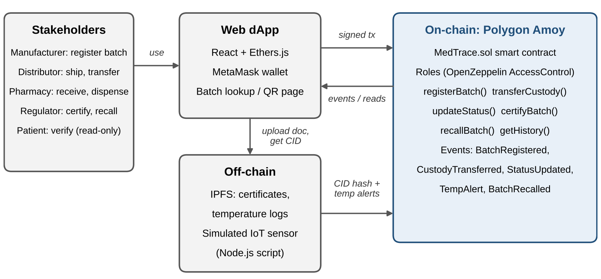

# MedTrace: Blockchain-Based Provenance for Pharmaceutical Supply Chains

**CSE 540: Engineering Blockchain Applications (Fall B 2026), Project 1**
**Team BlockRx:** Shrey Bishnoi, Maulik Jadav, Neric Joel, Vaibhav Abhiramacheri, Rohan Chandrashekar

> **Status: Smart Contract Design Draft (due 11/01/2026).** The contract interfaces, roles, storage, and core rules are written and compile. Items marked `TODO` in the code are planned for the Interim Demo (11/15) and Final Project (12/04).

---

## 1. Project Description

Prescription medicines pass through manufacturers, distributors, and pharmacies, and each of them keeps its own records. Because there is no shared, tamper-proof history, counterfeit or badly stored drugs can slip into the chain, and patients cannot easily check where their medicine came from.

**MedTrace** records every **batch** (one production lot of one medicine) on a blockchain:

- **Origin:** who made the batch, when, and its allowed storage temperature range
- **Custody:** every hand-off, signed by both the sender and the receiver
- **Documents:** certificates and logs stored on IPFS, with only their hashes (CIDs) kept on-chain
- **Cold chain:** temperature alerts from a simulated IoT sensor
- **Regulator actions:** certification and recalls

Anyone - including a patient, can look up a batch and see its full history and a simple **"safe to use"** answer.

### Stakeholders and roles

| Role | Who | What they can do on-chain |
|---|---|---|
| Admin | Network operator (deployer) | Onboard or remove participants |
| Manufacturer | Drug maker | `registerBatch`, start hand-offs, attach documents |
| Distributor | Wholesaler or logistics firm | `confirmReceipt`, pass the batch on |
| Pharmacy | Retail or hospital pharmacy | `confirmReceipt`, `markDispensed` |
| Regulator | Health authority | `certifyBatch`, `recallBatch`, attach certificates |
| Sensor | IoT simulator wallet | `recordTemperatureAlert` |
| Patient | Public | Read-only: `verifyBatch`, `getHistory` (free, no wallet needed) |

## 2. Architecture



- **On-chain (Polygon Amoy testnet):** the `MedTrace` contract stores batch state, history, and document CIDs, and emits an event for every action.
- **Off-chain storage (IPFS):** Certificates of Analysis, temperature logs, and shipping records.
- **Simulated IoT (Node.js):** generates temperature readings and writes only out-of-range readings on-chain to save gas.
- **Web dApp (React + Ethers.js + MetaMask):** one page per stakeholder, plus a public "verify my medicine" page.

The full design, including the status state machine, the hand-off sequence, and the design decisions, is in [`docs/design.md`](docs/design.md).

## 3. Repository Structure

```
medtrace/
├── contracts/
│   ├── MedTrace.sol              # main contract: batches, custody, documents, alerts
│   ├── interfaces/
│   │   └── IMedTrace.sol         # public interface: types, events, function signatures
│   └── access/
│       └── MedTraceAccess.sol    # role-based access control (OpenZeppelin)
├── test/                         # Hardhat/Chai tests (100 passing)
│   ├── MedTrace.test.js          # core flow, lot lookup, breach dispense rule, history pages (21)
│   ├── MedTrace.edgecases.test.js  # edge cases: custody, dispensing, expiry, recall, access (55)
│   └── deploy.test.js            # deploy script: helpers, files it writes, verification fallbacks (24)
├── scripts/
│   ├── deploy.js                 # deploy to localhost or Polygon Amoy
│   └── seedDemo.js               # local demo data: roles + one batch end-to-end
├── deployments/
│   └── amoy.json                 # written by deploy.js: address, tx hash, block
├── offchain/
│   ├── ipfs/uploadToIpfs.js      # IPFS upload helper (Pinata)
│   └── iot-simulator/simulateSensor.js  # temperature sensor simulator
├── frontend/                     # React dApp (planned for Interim Demo)
├── docs/
│   ├── architecture.png          # system architecture diagram
│   └── design.md                 # detailed design notes
├── hardhat.config.js
├── package.json
└── .env.example                  # template for secrets (never commit .env)
```

## 4. Smart Contract Overview

The interface (`IMedTrace.sol`) defines every type, event, and function. `MedTrace.sol` implements it.

| Function | Caller | Purpose |
|---|---|---|
| `registerParticipant(account, role, name)` | Admin | Onboard a wallet with a role and display name |
| `registerBatch(product, lot, expiry, minTemp, maxTemp, coaCid)` | Manufacturer | Create a batch; caller becomes its first holder |
| `transferCustody(batchId, to)` | Current holder | Step 1 of a hand-off (status becomes `InTransit`) |
| `confirmReceipt(batchId)` | Receiver | Step 2 of a hand-off (status becomes `Received`) |
| `markDispensed(batchId)` | Pharmacy holder | Final step: medicine given to patients |
| `attachDocument(batchId, docType, cid)` | Holder or Regulator | Link an IPFS document |
| `recordTemperatureAlert(batchId, reading, logCid)` | Sensor | Log an out-of-range temperature |
| `certifyBatch(batchId, certCid)` | Regulator | Approve the batch |
| `recallBatch(batchId, reason)` | Regulator | Pull the batch; it is frozen afterwards |
| `getBatch` / `getHistory` / `getDocuments` | Anyone | Read the batch record, audit trail, and documents |
| `verifyBatch(batchId)` | Anyone | Returns `exists`, `safeToUse`, `status`, and `holder` for the patient page |

**Events:** `BatchRegistered`, `CustodyTransferred`, `ReceiptConfirmed`, `BatchDispensed`, `DocumentAttached`, `TempAlert`, `BatchCertified`, `BatchRecalled`, `ParticipantRegistered`, `ParticipantRemoved`.

**Batch status flow:** `Created → InTransit → Received → (InTransit → Received …) → Dispensed`. A regulator can move any batch that hasn't been dispensed to `Recalled`.

## 5. Dependencies

| Tool | Version | Purpose |
|---|---|---|
| [Node.js](https://nodejs.org/) | 18 or newer (20 LTS recommended) | Runs Hardhat and the scripts |
| [Hardhat](https://hardhat.org/) | ^2.22 | Compile, test, deploy |
| @nomicfoundation/hardhat-toolbox | ^5.0 | Ethers.js v6, Chai matchers, gas reporter, verification |
| [@openzeppelin/contracts](https://docs.openzeppelin.com/contracts/5.x/) | ^5.0 | Audited `AccessControl` |
| Solidity | 0.8.24 | Contract language (Hardhat downloads it automatically) |
| dotenv | ^16 | Loads secrets from `.env` |
| [MetaMask](https://metamask.io/) | Browser extension | Wallet for testnet transactions |
| IPFS pinning service ([Pinata](https://pinata.cloud/)) | Free tier | Off-chain document storage (Interim Demo) |

## 6. Setup

```bash
git clone <this-repo-url>
cd medtrace
npm install
cp .env.example .env    # then fill in values (only needed for testnet)
```

## 7. Usage

### Compile and test

```bash
npx hardhat compile
npx hardhat test
REPORT_GAS=true npx hardhat test    # also print gas cost per function
```

On Windows PowerShell, set the variable first (it stays set for that window):

```powershell
$env:REPORT_GAS = "true"; npx hardhat test
```

### Gas report

Measured on the local Hardhat network with Solidity 0.8.24, optimizer on (200 runs) and `evmVersion` cancun, over the full test suite (100 tests). To reproduce, run `REPORT_GAS=true npx hardhat test` (PowerShell form above). Figures are gas units; `-` means the reporter saw only one value.

| Function | Min | Max | Avg | Calls |
|---|---:|---:|---:|---:|
| `registerBatch` | 287,196 | 440,478 | 426,343 | 65 |
| `certifyBatch` | 65,817 | 207,927 | 136,872 | 12 |
| `recordTemperatureAlert` | 66,100 | 208,456 | 179,768 | 10 |
| `attachDocument` | 155,369 | 157,785 | 156,180 | 6 |
| `recallBatch` | 88,384 | 91,256 | 89,140 | 8 |
| `registerParticipant` | 55,594 | 75,561 | 75,461 | 438 |
| `transferCustody` | 72,599 | 75,110 | 73,484 | 42 |
| `confirmReceipt` | - | - | 72,262 | 34 |
| `markDispensed` | - | - | 66,990 | 7 |
| `removeParticipant` | - | - | 28,890 | 3 |

**Deployment:** `MedTrace` costs 3,014,797 gas, 5.0 % of the block gas limit (60,000,000 on the local Hardhat network).

`registerBatch` is the most expensive call because it stores a new batch record with two strings (product name and lot number), adds the batch to the lot-number index, and writes a history entry that repeats the product name; with a Certificate of Analysis CID it also stores a document and a second history entry. The wide range for `certifyBatch` and `recordTemperatureAlert` comes from the same pattern: when a CID is passed, it is written into the history entry and into a separate document record. Every batch action appends a history entry, so even simple steps such as `confirmReceipt` and `markDispensed` cost around 66,000-73,000 gas. `verifyBatch` and `getHistory` are view functions, so a patient checking a batch sends no transaction and pays nothing.

The `registerBatch` minimum and average move by a few gas units between runs: the tests derive expiry dates from the current block time, and calldata cost depends on the bytes of that timestamp. All other figures are stable.

### Run locally with demo data

```bash
# Terminal 1: start a local blockchain with 20 funded test accounts
npx hardhat node

# Terminal 2: deploy, onboard one wallet per role, and move a batch to a pharmacy
npm run seed:local
```

### Run the temperature simulator (local)

After `seed:local`, set `CONTRACT_ADDRESS` and `SENSOR_PRIVATE_KEY` in `.env`. Use the sensor account's private key, which `npx hardhat node` prints as Account #5. Then run:

```bash
BATCH_ID=1 npm run iot:simulate
```

The simulator prints a reading every 3 seconds. When a reading is out of range, it uploads the full reading log to IPFS and records the alert on-chain with that log's CID. The CID also shows up in the batch's documents. By default it stops after one alert. Optional settings: `MAX_ALERTS` (`0` runs until Ctrl+C), `INTERVAL_MS`, `SPIKE_CHANCE` (0 to 1, default 0.1). If `PINATA_JWT` is not set, or the upload fails, the alert is still recorded, just without a log CID.

To run it on Amoy, set `RPC_URL` to the Amoy RPC and `CONTRACT_ADDRESS` to the deployed address. The sensor wallet must be granted `SENSOR_ROLE` by the admin first (`registerParticipant`) and needs a little test POL for gas.

### Upload a document to IPFS

Set `PINATA_JWT` in `.env` (Pinata dashboard → API Keys), then:

```bash
node offchain/ipfs/uploadToIpfs.js --test              # check the JWT works
node offchain/ipfs/uploadToIpfs.js path/to/coa.pdf     # prints the CID and a gateway link
```

From code: `const { uploadFile, uploadJson, gatewayUrl } = require("./offchain/ipfs/uploadToIpfs")`.

## 8. Deployment to Polygon Amoy Testnet

1. Add the Polygon Amoy network to MetaMask (Chain ID `80002`, RPC `https://polygon-amoy-bor-rpc.publicnode.com`). The older `rpc-amoy.polygon.technology` address no longer resolves.
2. Get free test POL from the [Polygon faucet](https://faucet.polygon.technology/).
3. Fill in `.env` (copied from `.env.example`):
   - `PRIVATE_KEY`: the deployer's private key, 64 hex characters. Use a test-only wallet, never one that holds real funds.
   - `ETHERSCAN_API_KEY`: only needed for source verification. One key from etherscan.io works for Amoy through Etherscan API V2, so no separate Polygonscan key is needed.
   - `AMOY_RPC_URL` can stay as it is.
4. Deploy:
   ```bash
   npm run deploy:amoy
   ```
   The script:
   - checks the wallet first and stops with a clear message if `PRIVATE_KEY` is missing or the wallet has no POL (it also warns if the balance looks too low for the estimated cost);
   - deploys `MedTrace` with the deployer as admin, printing the transaction hash as soon as it is sent and the address and explorer links once it is mined;
   - writes `deployments/amoy.json` (address, deployer, tx hash, block number, time, explorer link) and `frontend/src/contract.json` (address and ABI for the dApp);
   - if `ETHERSCAN_API_KEY` is set, waits 5 confirmations and verifies the source on the block explorer, retrying if the explorer has not indexed the contract yet.

   A failed verification does not undo the deployment. `deployments/amoy.json` holds only public data and should be committed.
5. If verification was skipped or failed, run it by hand (the script prints this command with the real values filled in):
   ```bash
   npx hardhat verify --network amoy <CONTRACT_ADDRESS> <ADMIN_ADDRESS>
   ```
6. Onboard the other team wallets with `registerParticipant` (through the dApp, Remix, or a Hardhat console).

### Deployed contract (Polygon Amoy)

| | |
|---|---|
| Contract | [`0x2749c1613F6dfF8283434885b985d287AC5FA2B8`](https://amoy.polygonscan.com/address/0x2749c1613F6dfF8283434885b985d287AC5FA2B8) |
| Deployment tx | [`0xe6d69a10…284de0`](https://amoy.polygonscan.com/tx/0xe6d69a10b7f47e037b84218103a5bdef8aa93e432c068cf513d8e187e4284de0) |
| Block | 52508013 (2026-11-10) |
| Admin (deployer) | `0xfd3E9AaCF697e02F9a186109838C9d2fD4A6dc78` |
| Chain ID | 80002 |
| Source | [Verified on Polygonscan](https://amoy.polygonscan.com/address/0x2749c1613F6dfF8283434885b985d287AC5FA2B8#code) |

The same details are in [`deployments/amoy.json`](deployments/amoy.json). To point the dApp at this contract, run `npm run sync-contract -- 0x2749c1613F6dfF8283434885b985d287AC5FA2B8 amoy` in `frontend/`.

This deployment includes lot-number lookup, the temperature-breach dispense rule and history pagination. It replaces the first deployment at `0x761F1e5344E376aB658e6d2AD8bA2f809c7C2A3f`, which predates those changes and should no longer be used. Roles and batches do not carry over: every participant has to be registered again on the new contract.

To onboard the demo participants (Acme Pharma, FastMed Logistics, Tempe Pharmacy, Drug Regulator) and give each one 0.15 test POL for gas, the admin runs this with the deployer's `PRIVATE_KEY` in `.env`. The wallets are listed in [`deployments/amoy-demo-participants.json`](deployments/amoy-demo-participants.json). Re-running it is safe, because finished steps are skipped.

```bash
npm run demo:onboard
```

## 9. Roadmap

| Milestone | Date | Scope |
|---|---|---|
| Smart Contract Design Draft | 11/01/2026 | Interfaces, roles, core logic, repo, README, initial tests ✅ |
| Interim Demo | 11/15/2026 | Amoy deployment, IPFS uploads, IoT simulator with real CIDs, first dApp pages |
| Final Project | 12/04/2026 | Complete dApp, full test coverage, gas analysis, IEEE report, presentation |

**Out of scope:** real sensor hardware, mainnet deployment, and integration with existing industry systems.

## 10. Team and Ownership

Every member owns a blockchain development task. Commit history in each area is the record of who built what.

| Member | Development task | Owns |
|---|---|---|
| Shrey Bishnoi | Web3 front-end app: MetaMask connection, Ethers.js contract wiring, role-based pages (manufacturer, distributor, pharmacy, regulator) | `frontend/` (app shell and role pages) |
| Vaibhav Abhiramacheri | Access control and regulator module, plus the patient "verify batch" page with live event listeners | `contracts/access/`, `certifyBatch` / `recallBatch`, `frontend/src/pages/Verify*` |
| Maulik Jadav | Core batch and custody logic, plus the open contract TODOs (lot-number lookup, `getHistory` pagination, dispense policy on temperature breach) | `contracts/MedTrace.sol` |
| Neric Joel | Contract tests, edge cases and gas report, plus Amoy deployment and explorer verification | `test/`, `scripts/deploy.js`, Amoy address in README |
| Rohan Chandrashekar | IPFS uploads (real CIDs on-chain) and the IoT simulator alert flow | `offchain/` |

**Workflow:** feature branches and pull requests, with at least one teammate reviewing each PR before merge. Tasks are tracked on the GitHub Projects board.

## 11. References

1. S. Nakamoto, "Bitcoin: A peer-to-peer electronic cash system," 2008.
2. V. Buterin, "Ethereum: A next-generation smart contract and decentralized application platform," 2013.
3. T. Bocek et al., "Blockchains everywhere – A use-case of blockchains in the pharma supply-chain," IFIP/IEEE IM, 2017.
4. MediLedger Project, "MediLedger DSCSA pilot project final report," 2020.
5. OpenZeppelin, *Access Control*: https://docs.openzeppelin.com/contracts/5.x/access-control

## License

MIT
