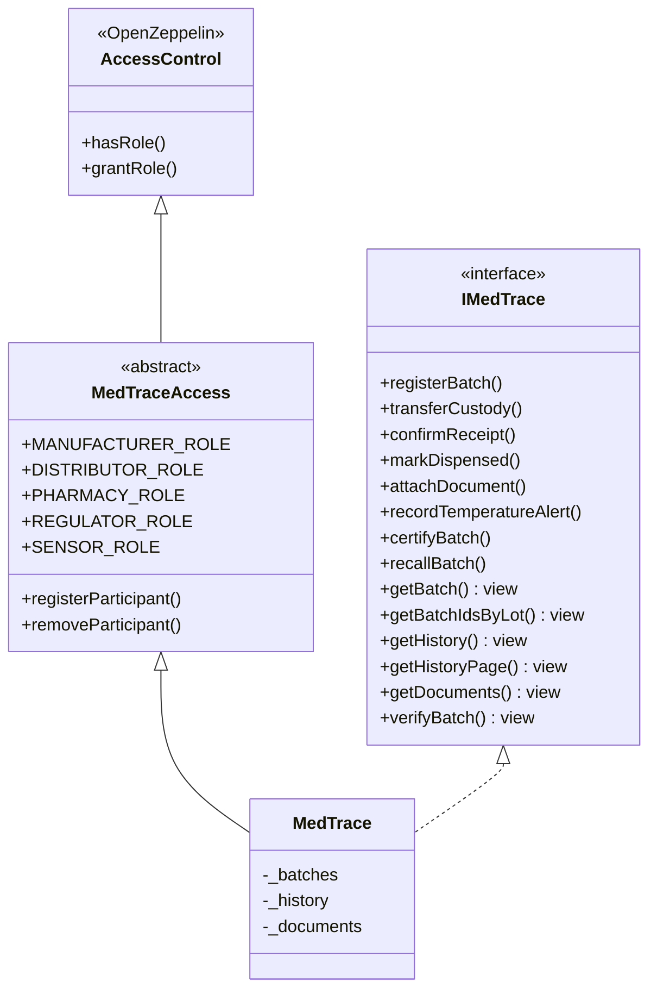
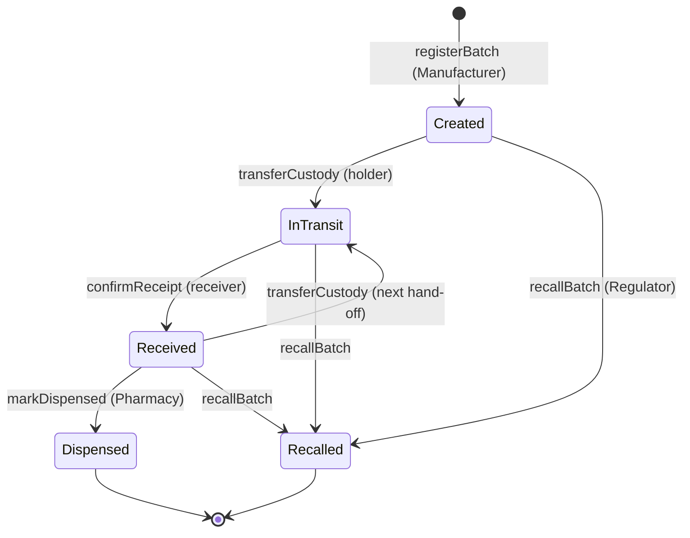
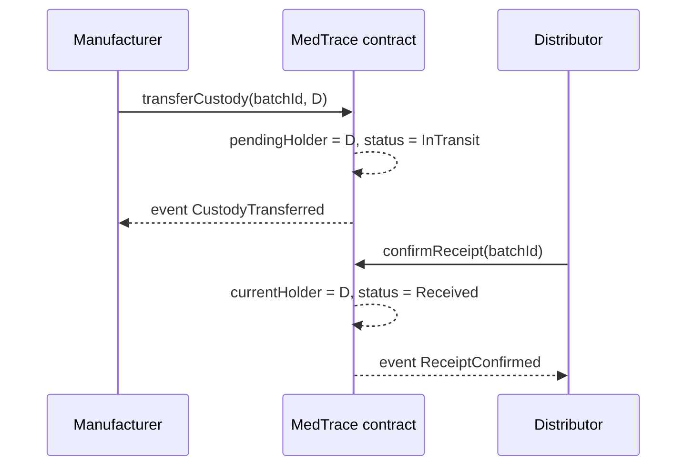

# MedTrace Design Notes

This document explains *why* the contracts look the way they do. Function-level details are in the NatSpec comments in `contracts/interfaces/IMedTrace.sol`.

## Contract components

- **IMedTrace**: the contract's public interface. The front end, scripts, and tests are written against it.
- **MedTraceAccess**: keeps permission logic separate from business logic, so roles can change without touching batch code.
- **MedTrace**: the storage and rules for batches.

## Batch status state machine

## Two-step hand-off

## Key design decisions

| Decision | Reason |
|---|---|
| **Polygon Amoy (public, EVM)** instead of Hyperledger Fabric | Patients must verify batches without permission; EVM tooling and OpenZeppelin are mature; low fees suit frequent updates. Fabric's multi-org setup is too heavy for six weeks. |
| **Two-step hand-off** (`transferCustody` + `confirmReceipt`) | Both parties sign, so no one can fake a delivery or dump a batch on someone else. |
| **Only CIDs on-chain** | Certificates and logs are large and may be sensitive; storing a hash proves integrity at a fraction of the gas cost. |
| **Only out-of-range temperatures on-chain** | Normal readings every few seconds would be expensive; alerts are what matter for safety. |
| **History stored in contract storage *and* emitted as events** | `getHistory` gives a simple one-call view for the patient page; events let the dApp update live. |
| **Temperatures as `int16` tenths of °C** | Solidity has no decimals; 2.0 °C to 8.0 °C is stored as 20 to 80. |
| **Recalled and dispensed batches are frozen** | Prevents a recalled batch from re-entering the supply chain. |
| **`verifyBatch` never reverts** | An unknown ID returns `exists = false`, which the UI shows as "not found, possibly counterfeit". |

## Lot lookup, dispensing, and history reads

`getBatchIdsByLot(lotNumber)` returns every matching batch ID in registration
order. Matching is exact and case-sensitive, including whitespace; an unknown
or empty lot returns an empty array. Lot numbers need not be globally unique:
a manufacturer may register several shipments of the same lot, and different
manufacturers may reuse a printed number. Patients should inspect each matching
batch's manufacturer and product using `getBatch` before calling `verifyBatch`.
The index is written atomically at registration and remains available after
custody changes, dispensing, or recall.

**Temperature breaches block dispensing on-chain.** `markDispensed` rejects a
batch with `temperatureBreached == true`, even when it is certified. An alert
permanently sets this flag, so later certification cannot override the block.
This matches `verifyBatch`, which already reports breached batches as unsafe.
Custody transfers remain available for returning or quarantining stock, and the
regulator may recall it. The contract has no breach-clearance mechanism; adding
one would require a separate policy and audit trail. Clean, received, unexpired
batches can still be dispensed by their pharmacy holder.

`getHistory` remains available for existing clients. `getHistoryPage(batchId,
offset, limit)` returns an oldest-first slice and the current total count. A zero
limit or an offset at/past the end returns an empty page; unknown batch IDs
revert. Oversized limits are clamped without arithmetic overflow. History is
append-only, so offsets remain stable as new entries arrive; clients needing a
consistent snapshot across calls should pin reads to a block number.

## Known limitations and planned work

- Batch splitting (one lot shipped to several distributors) is not modeled yet. Each shipment is registered as its own batch.
- Business data is public on-chain. A production version could use private transactions or zero-knowledge proofs, as MediLedger does.
- The sensor wallet is trusted. A real system would use signed device readings or an oracle network.
- Lot lookup returns all matching IDs in one call; very large lots may eventually need their own pagination.
